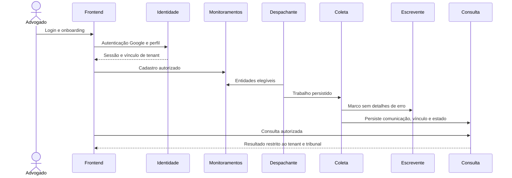

# Contratos técnicos para implementação

Este documento registra a arquitetura do monorepo e distingue componentes existentes dos ainda previstos. O estado funcional e as verificações já registradas estão no [README](../README.md); a stack e as versões centrais estão em [stack.md](stack.md). As especificações funcionais prevalecem sobre exemplos de estrutura.

A apresentação do frontend segue a [direção visual de UI, tipografia e cores](design-system.md): composição plana monocromática, cantos retos e fonte de sistema. O guia é documental; não indica frontend implementado nem altera os contratos funcionais.

## Estrutura do monorepo e fronteiras

Frontend Next.js, backend Rails API-only e processos de coleta pertencem ao mesmo repositório. A [estrutura na raiz](../README.md#estrutura-do-monorepo) registra os caminhos e seu estado atual. Não há repositório separado para a UI; separar dependências, imagens e processos não altera essa organização.

- `backend/`: Rails API-only, identidade, autorização, monitoramentos, consulta e persistência. `backend/app/` contém controllers, models e serviços; `backend/test/` contém testes Rails. Sessões são armazenadas no servidor; cookies de sessão são `Secure`, `HttpOnly` e `SameSite=Lax`, com proteção CSRF nas operações mutáveis. Google OpenID Connect autentica identidade por `iss` e `sub`, valida assinatura, audiência, expiração, nonce e e-mail verificado; dados fornecidos pelo cliente não constituem prova.
- `frontend/` (**previsto, ainda não criado**): Next.js com TypeScript e App Router; páginas em `frontend/app/`, componentes em `frontend/components/` e testes previstos em `frontend/tests/`. Tokens e estilos da UI pertencem a esse componente, orientados por `docs/design-system.md`. O navegador usa endpoints da mesma origem; um proxy no frontend encaminhará chamadas para o backend sem expor segredos ao navegador.
- `backend/despachante/` (**existente**): processo Ruby separado que planeja as duas execuções em Brasília e persiste trabalhos duráveis no PostgreSQL. Tem `Gemfile` e lockfile próprios, target Docker `despachante` em `backend/Dockerfile` e entrada `ruby despachante/run.rb` dentro da imagem. Integra o backend no mesmo monorepo, mas não inicializa nem executa dentro do servidor Rails. Usa conexão e role PostgreSQL próprias.
- `etl/` (**existente**): processo Ruby separado que executa um trabalho planejado por vez, consulta o DJEN e persiste resultados por transação. Possui `Gemfile`, lockfile e imagem próprios; não executa dentro da API ou do despachante. A seleção e o acionamento automático dos trabalhos permanecem na tarefa 13. Não é necessário Redis ou novo servidor de banco.
- `docs/` e `tasks/`: documentos e checklist existentes. PostgreSQL é o banco compartilhado; em deploy usa-se exclusivamente a instância já existente. Frontend e backend terão imagens distintas; empacotamento dos processos de planejamento e ETL deve obedecer às regras de usuário não root.

## Isolamento e privilégios

Dados de tenant carregam `tenant_id` obrigatório; chaves estrangeiras compostas incluem o tenant para impedir vínculos cruzados. A role de runtime não é dona das tabelas, não é superusuária nem possui `BYPASSRLS`, `TRUNCATE` ou permissão para alterar políticas. A role de migração é separada e não usada pela aplicação. Cada transação autentica o contexto antes de definir o tenant com configuração local à transação; ausência ou valor inválido resulta em nenhuma linha visível ou alteração permitida. RLS é habilitado e forçado para todas as tabelas de tenant, com `USING` e `WITH CHECK` exigindo igualdade com o tenant confiável. O pool não pode conservar contexto após commit ou rollback. A autorização por operação e tribunal é aplicada adicionalmente no servidor, antes da consulta ou escrita; RLS não a substitui.

Dados de bootstrap de identidade e associação devem ser acessados por interface mínima separada e controlada, sem consulta geral de tenants. Jobs carregam identificadores de trabalho persistidos e estabelecem o contexto por transação. O Escrevente é append-only: runtime recebe apenas `INSERT` e `SELECT`, sem `UPDATE`, `DELETE` ou `TRUNCATE`; não há expurgo automático nesta etapa. As políticas e permissões devem ser verificadas com a role real e dois tenants, inclusive após reutilização de conexão. Consulte [PostgreSQL RLS](https://www.postgresql.org/docs/18/ddl-rowsecurity.html).

## Contratos de módulo

1. Identidade autentica Google e resolve servidor-side usuário, vínculo, tenant e validade; o acesso de equipe é negado no instante de expiração ou revogação, mesmo para sessão aberta. Onboarding cria perfil do advogado e tenant em transação.
2. Autorização recebe contexto confiável, operação e tribunal; devolve permissão ou negação antes de acessar listas, detalhes e agregações. A política funcional de grupos permanece em `SPEC-autorizacao.md`.
3. Monitoramentos fornece entidades elegíveis e filtros por tenant ao despachante. O despachante gera trabalho por execução/tenant/entidade/tribunal/meio, exclusivamente Diário Eletrônico (`D`), sem editais (`E`). Uma chave única para essa combinação impede duplicação do planejamento; claims transacionais e idempotência protegem retomadas concorrentes.
4. ETL consulta caderno com fallback API no primeiro slot e API diretamente no segundo, sem caderno, sempre no meio `D`, com matching conforme `SPEC-coleta.md`; persiste publicação e vínculos por tenant, com chave conjunta `id` e `hash`. Sanitiza somente `texto` da API, não do caderno. A primeira versão deduplicada pode conter HTML e não é substituída por uma versão posterior sanitizada; o consumidor deve escapar o conteúdo na renderização. Resultado e estado por execução/tribunal pertencem à coleta. Trabalhos com falha não viram zero publicações.
5. Escrevente recebe marcos de fluxo com tenant, execução e instante, sem ações de usuários nem detalhes de erro. Consulta lê publicações e estado após autorização e não infere sucesso a partir de ausência de registros.

## Identidade, convites e documentação

- Google OpenID Connect usa authorization code com PKCE, `state` e `nonce` de uso único; o callback valida issuer, assinatura, audiência, validade e e-mail verificado. Rotacionar a sessão após autenticação. O usuário pode pertencer a mais de um tenant: seleção de vínculo é validada no servidor contra credencial vigente, nunca aceita apenas por ID enviado; cada requisição revalida o vínculo selecionado.
- Convite usa token aleatório de pelo menos 256 bits, armazenado apenas como hash, de uso único e válido por 24 horas ou até revogação/expiração da credencial, o que ocorrer primeiro. O advogado informa e-mail e grupos; enviar o link por SMTP configurado. Na aceitação, verificar token e que o e-mail Google verificado corresponde ao convidado; consumir token e ativar vínculo atomicamente. Uma nova emissão invalida o token anterior e não reinicia a validade da credencial. Não registrar tokens ou conteúdo do convite em logs.
- Swagger UI e especificação OpenAPI são protegidos separadamente do login Google com HTTP Basic servido exclusivamente por HTTPS no backend. Usuário e hash de senha são fornecidos por configuração externa de segredo; sem configuração, negar acesso. Comparar senha pelo algoritmo de hash escolhido na implementação e limitar tentativas; nunca embutir credenciais ou valores padrão. A proteção deve abranger HTML, JSON/YAML e assets privados.
- No onboarding, nome e OAB seguem os critérios de [monitoramentos](../SPEC-monitoramentos.md#contratos-lógicos): nome não vazio após normalização de espaços; número OAB textual não vazio e UF válida; inscrição principal obrigatória e secundárias opcionais. Um par número/UF repetido no mesmo perfil é recusado; preservam-se zeros e sufixos. Não se presume consulta a registro externo.

## Ferramentas e comandos previstos

Após a geração e instalação autorizadas, executar no diretório `backend/`: `bin/rails server`, `bin/rails test` e `bin/rubocop`; em `frontend/`: `npm run dev`, `npm run build`, `npm run lint` e `npm test`. Os scripts e RuboCop devem ser incluídos no projeto gerado antes desses comandos serem exigidos. São comandos planejados, não executados ou verificados nesta fase; versões de bibliotecas transitivas e compatibilidade dependem de lockfiles e verificação real. Antes de implementar cada fatia, registrar os nomes exatos de arquivos e subdividir se ultrapassar cinco; não presumir que um gerador manterá os caminhos propostos.

## Ferramentas propostas

Rails usa Minitest padrão e testes de integração; frontend usa TypeScript e ESLint, testes de componentes com Vitest e testes de navegador com Playwright. Ruby 4.0.9, Rails 8.1.4, Next.js 16.4.1, PostgreSQL 18.6 e Node.js 24.22.1 são referências de versão; [Node.js 24.22.1](https://nodejs.org/en/blog/release/v24.22.1) é LTS. Dependências exatas e lockfiles serão gerados e validados quando a implementação for autorizada; nenhuma instalação ocorreu. Comandos reais só podem ser confirmados após criação da aplicação; não se declara que comandos ou integração estejam funcionando.

## Verificação de arquitetura

Exercício de mesa: uma requisição autenticada de A não pode selecionar o tenant B por parâmetro; a autorização limita tribunal, e RLS limita linhas a A. O despachante cria trabalho para A; o worker estabelece contexto A e grava comunicação e vínculo A. O Escrevente recebe marco sem detalhes de erro. Consulta retorna apenas dados de A autorizados. Ausência de contexto ou falha do worker não gera sucesso nem amplia acesso. Validação real, concorrência e teste com role de runtime continuam obrigatórios na implementação.

Sequência de revisão documental, não execução:

Revisão de bordas: dois homônimos com mesmo nome canônico correspondem sem desambiguação; um tribunal selecionado que fique indisponível permanece selecionado sem ampliar o filtro; publicação sem chave válida fica separada e pendente com aviso de possível duplicidade. Esses casos são exercícios de contrato, não testes executados.
