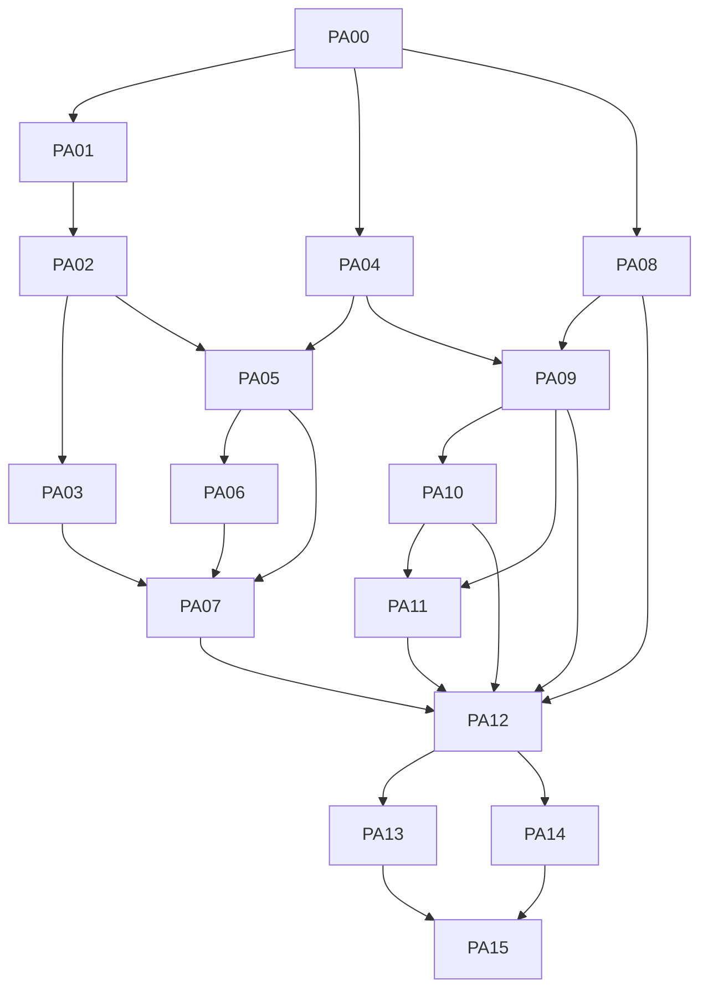

# Plano: primeiro acesso controlado

## Autorização de implementação e pipeline

O solicitante autorizou executar este plano e criar a [issue #16](https://github.com/smcruzfilipe/advocaciaonline/issues/16), com [plano e handoff publicados](https://github.com/smcruzfilipe/advocaciaonline/issues/16#issuecomment-6554202739). As restrições históricas de entrega apenas documental abaixo descrevem PA00, não impedem esta execução autorizada.

| Fase do pipeline | Unidades | Gate |
|---|---|---|
| Planejamento | PA00 e preparação | Fontes, contratos, inventário, decisões e plano publicados na issue. |
| Execução inicial | PA01–PA12 | Folhas e checkpoints aprovados; corte integrado; um único PR draft após PA12. |
| Refinamento | PA13–PA15 | Conferência de consumidores, documentação e validação integrada real em ambiente descartável. |
| Finalização | Fechamento do mesmo PR | Caminho definitivo antes de limpar provas, DoD integral, reviews resolvidas e CI terminal verde; retirar draft somente depois. |

A publicação em draft após PA12 é exceção expressamente autorizada à regra anterior de branch não publicada. Permanecem as revisões humanas R02–R18 e todos os checkpoints; não inferir aprovação antecipada de resultados. Não há autorização de deploy nem de ações destrutivas em banco persistente.

## Estado, objetivo e limites da autorização

**Estado: plano aprovado pelo solicitante; PA00 concluída documentalmente.** A [SPEC-primeiro-acesso.md](../SPEC-primeiro-acesso.md) registra as [decisões escolhidas por delegação](../SPEC-primeiro-acesso.md#decisões-de-pa00), integradas e revisadas independentemente. Foram conferidos links, critérios, dependências, limites das folhas e sintaxe dos exemplos de shell. Isso não comprova execução da aplicação nem autoriza implementação, testes da aplicação, infraestrutura ou deploy; os comandos abaixo permanecem propostas de verificação futura.

O objetivo é substituir o cadastro público do advogado por uma liberação emitida exclusivamente pela administradora da plataforma, preservando contas existentes, recuperação segura, senha e TOTP e o cadastro de membros convidados. Convite de equipe autoriza participação no tenant convidante; não autoriza criação de tenant próprio. A conclusão deve ser segura tanto pela interface quanto por HTTP e pelas funções de banco acessíveis à role de runtime.

O registro de tarefas, critérios, arquivos propostos e evidências é [todo-primeiro-acesso.md](todo-primeiro-acesso.md). Somente PA00 está concluída, como entrega documental; PA01–PA15 permanecem abertas. Este plano mantém contexto, decisões, dependências e estratégia, sem duplicar o checklist. Os arquivos `tasks/plan.md` e `tasks/todo.md` contêm outro trabalho aberto e não devem ser sobrescritos, encerrados ou renomeados para acomodar esta entrega.

Não fazem parte deste plano integração automatizada com WhatsApp, contas de demonstração, deploy, mudanças de outros produtos ou alterações destrutivas de dados. Reutilizar Rails/Next/PostgreSQL, autenticação, sessão, senha/TOTP, recuperação, SMTP e perfil existentes; não criar outro aplicativo, provedor, stack de identidade, fila ou serviço. Novas dependências não são presumidas nem aprovadas. A aprovação deste plano não libera código, publicação de estados intermediários ou qualquer gate operacional.

## Fontes e estado real observado

A spec governa o comportamento futuro; os caminhos abaixo ancoram o diagnóstico do código atual. [SPEC-identidade.md](../SPEC-identidade.md), [docs/arquitetura.md](../docs/arquitetura.md) e a documentação web preservam seus contratos atuais; o desenho ainda não implementado fica na spec de primeiro acesso e neste planejamento separado. Trechos históricos não substituem inspeção do código nem comprovam verificações desta entrega.

| Fronteira atual | Fonte real | Consequência para o planejamento |
|---|---|---|
| Cadastro por senha público | `apps/backend/config/routes.rb`; `apps/backend/app/controllers/password_auth_controller.rb`, ações `register` e `verify_email` | `POST /api/auth/register` não exige conta autenticada; valida origem/ingresso, limita tentativas e emite confirmação. `verify_email` usa token e cookie de registro. Remover apenas o botão não fecha a criação por API. |
| Login e recuperação | `apps/backend/app/controllers/password_auth_controller.rb`; `apps/backend/app/services/password_authentication.rb`; `apps/backend/db/migrate/20261101000000_replace_google_with_password_totp.rb`; `apps/backend/db/migrate/20261101000001_add_password_reset.rb` | A sessão depende de senha e TOTP. Recuperação atual usa link de 30 minutos, uso único, invalida o anterior, revoga sessões/desafios e preserva TOTP; não oferece recuperação de autenticador. Q1 acrescenta futuramente códigos administrativos somente para reinscrição de TOTP, sem autenticação alternativa definitiva. |
| Identidade e e-mail | `apps/backend/app/services/identity_store.rb`; migrations de identidade, senha/TOTP, recuperação e equipe | `identities.verified_email` é usado no lookup, recuperação e comparação no aceite de equipe. Q5 exige migrar esses consumidores para separar endereço canônico de login, verificação real nullable e liberação de titularidade; não fingir prova de caixa para o advogado convidado. |
| Criação de tenant e perfil | `apps/backend/app/controllers/onboardings_controller.rb`; `apps/backend/app/services/lawyer_onboarding.rb`; `apps/backend/db/migrate/20261028000000_create_identity_and_lawyer_profiles.rb` | `POST /api/onboarding` invoca `LawyerOnboarding.call`; `claim_tenant` ocorre na transação do onboarding, separada do cadastro da credencial. A autorização administrativa deve alcançar também essa função, não só o controlador. |
| Equipe convidada | `apps/backend/app/controllers/team_invitations_controller.rb`; `apps/backend/db/migrate/20261028000005_create_team_credentials.rb`; `apps/backend/test/integration/team_invitations_test.rb` | O aceite exige identidade autenticada com o mesmo e-mail verificado. Depois de fechar o cadastro público, um membro novo ainda precisa criar conta sob convite válido, confirmar seu e-mail e passar pelo TOTP. |
| Login e navegação web | `apps/web/src/components/login-screen.tsx`; `apps/web/src/components/session-provider.tsx` | O login combina entrada e cadastro. O provider captura `#token` quase globalmente, exceto nas rotas de verificação e recuperação. Um novo tipo de link não pode ser capturado como convite de equipe nem substituir um fluxo pelo outro. |
| Relay e preservação do convite | `apps/web/src/app/api/transport.ts`; `apps/web/src/app/convite/preservar/invitation-body.ts`; `apps/web/src/app/api/transport.test.mjs` | Há allowlist de endpoints, filtros de cookies e cabeçalhos privados. O novo caminho reutiliza a sessão comum, com capacidade administrativa checada no Rails, e distingue convite de advogado, equipe e recuperação; não cria cookie ou sistema de login administrativo paralelo. |
| Transporte SMTP | `apps/backend/app/services/team_invitation_mailer.rb`; `README.md` | O transporte existente exige STARTTLS e oculta detalhes de exceções que podem conter segredos. Serve de referência técnica, não de autorização para reutilizar assunto ou semântica de convite de equipe. |
| Fixtures e CI | `.github/workflows/backend.yml`; `.github/workflows/web.yml`; `apps/backend/test/`; `apps/web/package.json` | O smoke do despachante chama diretamente `register_password` e `verify_password_email` antes do onboarding. Cada mudança desse contrato precisa migrar na mesma unidade integrada as preparações e os consumidores efetivamente afetados; PA13 confere e consolida o resultado, sem preservar bypass nem adiar compatibilidade. |
| Banco e operação | `AGENTS.md`; `README.md`; `apps/backend/db/provision.sql`; `apps/backend/db/provision_despachante.sql`; `apps/backend/db/provision_processador.sql` | Roles são separadas e RLS deve permanecer efetivo. Migrations consolidadas destinam-se a banco inicial vazio, não fornecem upgrade automático nem rollback destrutivo de banco existente. Containers devem iniciar e executar sem root. |

### Comportamentos aprovados que o desenho deve preservar

- Somente a administradora autenticada e autorizada emite e recupera links. Autenticação de advogado ou membro não concede acesso administrativo; a verificação é server-side em toda operação administrativa.
- A administradora informa somente o e-mail e pode enviar pelo SMTP ou copiar o link para compartilhamento manual por WhatsApp. São canais para a mesma autorização, sem integração automatizada e sem vincular a cópia ao sucesso do SMTP.
- Cada link é associado a um e-mail imutável na conclusão, vale por 24 horas desde a emissão e é de uso único. Abrir ou consultar o link não o consome. No instante exato de emissão + 24 horas e depois, a conclusão é negada no servidor; acessos concorrentes permitem no máximo uma conclusão bem-sucedida.
- O advogado preenche os dados profissionais existentes, incluindo nome e OAB, **sem confirmação adicional de e-mail**. O link é uma credencial de cadastro: quem o obtiver antes do vencimento e uso pode utilizá-lo, independentemente do canal. Isso não prova posse da caixa postal.
- Conta nova prepara senha/segredo/challenge pendentes, sem identidade ativa, liberação, sessão ou reset elegível. Confirmar senha preparada + primeiro TOTP + convite dentro de 24 horas cria atomicamente identidade/credencial confirmada/liberação, consome convite e estabelece sessão comum pelo mecanismo existente, com cookie somente após commit e passo TOTP registrado contra replay. Seguir direto ao perfil/tenant, em transação separada; login normal é retomada após interrupção, não segunda autenticação imediata. Conta preexistente reutiliza sua sessão com senha/TOTP da mesma identidade/e-mail, sem mudar credenciais.
- Reemissão é explícita e invalida o anterior atomicamente; copiar ou reenviar recupera o mesmo link ativo sem prorrogar 24 horas. Titular já com tenant recebe conflito administrativo e orientação de login; conta desativada não é reativada pelo convite.
- Cadastro público do advogado deixa de existir na interface e na API. A orientação é o texto de Q2, sem contato fictício ou botão de canal. A equipe continua criando conta apenas sob convite válido, com confirmação real de e-mail e TOTP, sem autorização implícita de titularidade.
- Contas existentes e convites de equipe preservam seus contratos, incluindo isolamento, validade/revogação e exigências de autenticação. O contrato de recuperação deve continuar seguro; não tratar e-mail autorizado por link como e-mail comprovadamente verificado nem introduzir recuperação de TOTP por efeito colateral.
- Falha SMTP é comunicada sem afirmar entrega; aceitação SMTP não comprova recebimento. Tokens, senhas e credenciais não podem aparecer em logs, documentação, respostas indevidas ou requisições a terceiros.

## PA00: decisões registradas e validação documental

A fonte normativa é [SPEC-primeiro-acesso.md — Decisões de PA00](../SPEC-primeiro-acesso.md#decisões-de-pa00). O solicitante delegou as recomendações restantes, com preferência pela solução mais simples e sem suposições. O resumo orienta a execução futura; não cria contrato paralelo nem afirma código existente. A revisão e a validação documental de PA00 foram concluídas.

| Questão decidida | Resumo e consequência para o plano |
|---|---|
| Q1 — Administração e recuperação | Conta única provisionada por procedimento protegido; reutilizar senha/TOTP/sessão comuns e capacidade server-side. Senha+código de uso único só habilitam reinscrição de TOTP; reset por e-mail mantém MFA. Sem TOTP nem códigos, não há recuperação normal ou bypass. PA01–PA03; detalhes na spec. |
| Q2 — Orientação de acesso | Texto normativo sobre convite/contato com o responsável, sem inventar contato, configuração ou botão de canal. PA12/PA14. |
| Q3 — Colisões e reemissão | Um convite ativo por e-mail; substituição explícita atômica, cópia/reenvio sem prorrogação. Titular com tenant recebe conflito; conta existente sem tenant próprio resgata autenticada, sem duplicar conta/redefinir credenciais ou reativar desativada. PA04–PA11. |
| Q4 — Contas e pendências | Preservar identidades, credenciais, tenants e sessões válidas; invalidar tokens públicos pendentes sem criar contas ou apagar dados. Ausência de tenant e convite de equipe não concedem titularidade. PA08–PA12/PA14. |
| Q5 — Endereço e liberação | Separar endereço de login, verificação real nullable e liberação por identidade, migrando consumidores sem falsificar prova de caixa. Reset de conta ativa mantém TOTP; preparação nova não é elegível. Equipe exige confirmação específica quando a identidade ainda não tem prova real. PA08–PA11. |
| Q6 — Minimização | Sem histórico/auditoria nova: eliminar terminais e expurgar expirados oportunisticamente nas operações necessárias, seguindo o padrão de `pending_registrations`; sem atividade, não prometer prazo físico. Sem rake/cron/job/serviço novo. Após restore, invalidar todos os convites administrativos restaurados antes da reabertura, preservando identidades/liberações válidas do snapshot. PA04/PA14; detalhes na spec. |

### Ambiguidades técnicas decididas

- **Consumo, expiração e retomada:** preparação nova não ativa conta nem permite reset; posse do convite permite reiniciar pendência sem prorrogar prazo. Confirmar senha preparada/TOTP/convite dentro de 24 horas conclui conta/liberação/consumo e sessão comum atomicamente; cookie só após commit e passo TOTP protegido contra replay. Ir direto ao perfil/onboarding existente, sem pedir senha/TOTP outra vez. Se interrompido depois, retomar por login normal; erro de perfil não desfaz conta/liberação nem exige outro convite. Preexistente usa sessão autenticada sem alterar credenciais; perfil/tenant continuam atômicos separadamente.
- **Autorização durável:** o segredo consumido deixa de existir; a liberação fica na identidade. PA10 exige-a em HTTP, serviço e `app_private.claim_tenant`, inclusive chamada direta como runtime. Ausência de tenant ou convite de equipe não concede titularidade.
- **Mesmo link recuperável:** token opaco aleatório de 256 bits, hash para lookup/consumo e cópia cifrada autenticada só enquanto ativo. Reusar criptografia Rails com finalidade/chave derivada distinta de TOTP e `SECRET_KEY_BASE` existente, sem nova variável, JWT ou criptografia própria; segredo só é retornado à administradora autorizada, com `no-store`, e removido nas transições de Q6.
- **Rotas e sessão:** `/admin` e `/admin/convites` na aplicação existente usam login/sessão comuns e capacidade administrativa server-side. `/primeiro-acesso#token=...` remove fragmento e guarda token só em memória do formulário, excluído da captura de equipe. Reabrir link retoma antes do consumo; confirmação bem-sucedida segue direto ao perfil, e interrupção posterior retoma por login normal. HTTP/proteções seguem a fonte normativa, sem duplicação de cookies, login ou stack.
- **SMTP:** persistir emissão antes do envio; falha mantém o mesmo link ativo/copiável. Timeout pode ter resultado desconhecido; copiar/reenviar são ações explícitas do mesmo link, sem retry automático/fila. Aceitação SMTP não é entrega.

DTOs, nomes de função SQL, arquivos novos e timestamps das migrations são detalhes técnicos a ratificar na folha antes de codificar, não novas perguntas funcionais. PA00 está concluída documentalmente; PA01–PA15 continuam trabalho futuro, sem autorização de execução nesta etapa.

## Grafo PA00–PA15 e rastreabilidade

Os IDs PA00–PA15 são estáveis; a tabela canônica de dependências pertence a [todo-primeiro-acesso.md](todo-primeiro-acesso.md). O Mermaid abaixo representa essas mesmas dependências, sem criar arestas pela ordem-base das fases ou pela propriedade de arquivos. Dependência indica pré-requisito mínimo, não permissão de publicar uma fatia isolada. O índice mantém somente fatia e rastreio; critérios detalhados, limites de arquivos e verificações por unidade ficam no todo.

| ID | Fatia | Rastreio funcional principal |
|---|---|---|
| PA00 | Decisões e validação documental | Concluída documentalmente: Q1–Q6, ambiguidades, revisão independente e consistência dos artefatos; não implementa o fluxo. |
| PA01 | Provisionamento e autorização da administradora | Conta única no mecanismo existente, recuperação de MFA e capacidade server-side. |
| PA02 | Sessão comum e proteção administrativa | Reuso de login/TOTP/reset e autorização server-side; recusa de anônimo/usuário sem capacidade. |
| PA03 | Destino administrativo no login comum | Entrada e recuperação administrativas sem outra sessão, tela de login ou stack. |
| PA04 | Persistência/ciclo do convite do advogado | 24 horas, uso único, colisões, concorrência e expurgo Rails sem histórico novo. |
| PA05 | Emissão e acesso ao link servidor | E-mail vinculado, emissão/recuperação somente administrativa. |
| PA06 | Envio SMTP e falhas | Canal SMTP, erro fiel, cópia independente e sigilo. |
| PA07 | UI para gerar/enviar/copiar | Escolha de canal e feedback sem integração WhatsApp. |
| PA08 | Cadastro de equipe convidada mantendo verificação e TOTP | Conta nova sob convite válido, verificação do mesmo e-mail e dois fatores. |
| PA09 | Resgate de convite/credencial sem afirmar posse de email | Conclusão atômica e única, prazo e classificação correta de identidade. |
| PA10 | Exigir autorização administrativa para tenant próprio | Impedir titularidade via equipe, onboarding direto ou `claim_tenant`. |
| PA11 | UI link e onboarding advogado | Perfil/OAB, TOTP e resgate sem confirmação extra de caixa. |
| PA12 | Cutover completo interface/API | Retirar cadastro público por completo e migrar consumidores, sem bypass. |
| PA13 | Consolidação de fixtures e smoke CI | Conferir os consumidores já migrados nas mudanças de contrato e consolidar o smoke final do CI, sem postergar correções. |
| PA14 | Documentação operacional/contratos/envs | Contratos, operação, envs exatas e corte/retorno aprováveis. |
| PA15 | Validação integrada/evidências | Aceites 1–8 da spec, regressões, segurança e revisão humana final. |



### Fases, checkpoints e revisão humana

Cada folha executável é uma fatia verificável **internamente em branch**, não um estado de produção autorizado. Pais PA subdivididos são agregadores, não unidades executáveis nem contadores de checkpoint. Antes de avançar para outra folha, tarefa ou fase, a unidade integrada precisa deixar a árvore funcional, com os gates pertinentes verdes, incluindo regressões dos consumidores afetados; um teste focado do novo caminho não basta se outro consumidor do contrato ficou incompatível. Um checkpoint exige revisão humana e evidências pertinentes à etapa quando sua execução for autorizada; ausência de evidência, gate vermelho ou decisão bloqueante interrompe a sequência. Não marcar o checkpoint como aprovado por este documento existir.

| Fase | Ordem-base de pais agregadores | Marco de fase, sem substituir checkpoints de folhas |
|---|---|---|
| Decisões e fronteira administrativa | PA00, PA01, PA02 | Revisão bloqueante ao fechar PA00, antes de código; checkpoint C1 após PA02, com origem do privilégio, recuperação e recusa de acesso administrativo indevido. |
| Login administrativo e ciclo servidor | PA03, PA04, PA05 | C2 após PA05: contrato de link, prazo, estados, retenção, concorrência e recuperação do segredo. |
| Canais e preservação de equipe | PA06, PA07, PA08 | C3 após PA08: erro SMTP/cópia, UX administrativa e criação de conta de equipe com verificação/TOTP. |
| Resgate e titularidade | PA09, PA10, PA11 | C4 após PA11 **e antes de PA12**: consumo/atomicidade, expiração durante o fluxo, recuperação, bloqueio de `claim_tenant` e onboarding web. |
| Integração sem publicação | PA12, PA13, PA14 | C5 após PA14: nenhum cadastro público remanescente, consolidação de fixtures/CI já compatíveis e documentação operacional coerente. |
| Evidência final | PA15 | C6 final: aceites end-to-end, regressões e autorização humana específica para qualquer passo posterior. Não é autorização de deploy. |

Os marcos C1–C6 organizam a revisão por assunto, mas não substituem checkpoints a cada **2–3 folhas executáveis concluídas**, inclusive dentro de um único PA. Antes de executar, registrar a ordem efetiva das folhas e esses checkpoints intermediários no todo, respeitando as dependências canônicas e a revisão imediatamente antes do cutover. Contar somente pais agregadores permitiria avançar por muitas folhas sem revisão; paralelização ou novas subdivisões exigem ajustar a agenda de checkpoints, não dispensá-los nem mudar os IDs PA ou suas dependências.

**Tamanho das unidades:** no máximo cinco arquivos alterados por folha, contando testes e documentação. Reservar um para atualização do todo deixa no máximo quatro arquivos funcionais; qualquer outro documento alterado também entra nessa conta. Quando a lista real ultrapassar o limite, subdividir a tarefa em folhas internas **antes da execução**, com arquivos explícitos, proprietário, critérios, teste focado e smoke próprios, sem criar novos IDs PA nem alegar conclusão do pai antes de terminar todas. A subdivisão deve preservar compatibilidade em cada folha; se a fronteira proposta exige deixar consumidores quebrados até uma folha posterior, redesenhar a divisão antes de alterar o contrato. A lista de arquivos novos do todo é uma proposta nominal a fixar antes de implementar; não é prova de arquivo existente nem aprovação de arquitetura.

### Compatibilidade na unidade que altera o contrato

PA08, PA09 e PA10 podem alterar, respectivamente, registro de equipe, semântica de identidade/resgate e autorização de titularidade. Antes de cada mudança, inventariar os helpers, callers, fixtures, testes e preparações de smoke que realmente dependem do contrato alterado. Migrar todos os afetados **na mesma unidade integrada da alteração**, antes de avançar; não reservar essa correção para PA12, PA13 ou PA15. Isso é um risco concreto de dependência observado no planejamento, não relato de teste que falhou: nenhum teste foi executado nesta etapa.

Se esse inventário ultrapassar o teto de arquivos, registrar previamente as folhas compatíveis e sua ordem de integração, com um proprietário dos arquivos compartilhados. Preparações podem anteceder a mudança de contrato somente se mantiverem o sistema funcional, sem shims, concessão global de autorização, caminho público residual ou bypass temporário. Não avançar com árvore vermelha nem alterar expectativas incidentais só para passar testes. Se não houver divisão compatível dentro do limite, a execução fica bloqueada até redesenhar a unidade.

Nem todo teste ou caller necessariamente muda. Registrar o motivo de cada consumidor relevante **intencionalmente inalterado**, preservando suas afirmações de negócio. Referenciar no PA13 as migrações e evidências da unidade de origem, sem duplicar implementação: PA13 continua dependente de PA12 e é a conferência/consolidação final de fixtures, demais consumidores e smoke CI, nunca autorização para adiar compatibilidade da suíte.

### Paralelização e propriedade de arquivos

Após validação de PA00 e autorização própria de implementação, PA01 e PA04 e PA08 admitem trabalho independente se não disputarem migrations, identidade ou contratos. Após PA02, PA03 pode avançar enquanto PA05 integra PA04; após PA05, PA06 pode avançar enquanto outra frente completa partes independentes do fluxo de equipe/resgate. PA13 e PA14 podem avançar em paralelo depois de PA12. Esses são limites do grafo, não autorização para dispensar checkpoints.

Antes de distribuir trabalho, fixar interfaces, nomes de arquivo, ownership e exemplos de estado. Um único responsável integra mudanças em `apps/backend/config/routes.rb`, migrations/GRANTs de identidade, `password_auth_controller.rb`, `password_authentication.rb`, `identity_store.rb`, `apps/web/src/app/api/transport.ts`, `session-provider.tsx` e `login-screen.tsx`; não editar esses mesmos arquivos simultaneamente. Atribuir também proprietário único a `apps/backend/test/test_helper.rb`, helpers de suporte, testes compartilhados e workflows tocados por mais de uma frente; a unidade que muda o contrato é responsável pela migração compatível e as posteriores a referenciam, sem duplicá-la. Reusar a sessão comum não concede administração: toda operação verifica a capacidade no servidor, sem expor segredo de sessão ao cliente ou criar sessão paralela. O integrador coordena as verificações após as frentes da unidade pousarem e antes de avançar, sem executar gates concorrentes sobre alterações parciais.

## Riscos, fronteiras de confiança e mitigação

Ativos principais: credencial administrativa, token de convite, senha/TOTP, vínculo identidade–e-mail e autorização de criar tenant. Fronteiras: navegador–relay, relay–Rails, API–funções privilegiadas do banco e aplicação–SMTP. Compartilhar um link por qualquer canal transfere uma credencial; não representa prova da caixa postal.

| Risco | Impacto | Mitigação e evidência futura |
|---|---|---|
| Confundir autorização de endereço com verificação da caixa | Recuperação indevida, aceite de equipe incorreto ou informação falsa na identidade | Aplicar Q5 e migrar todos os consumidores de `verified_email`; testar contas verificadas e autorizadas por link separadamente, com confirmação específica apenas para aceite de equipe quando necessária. |
| Fechar cadastro público e impedir membro novo | Convite de equipe deixa de funcionar | PA08 fornece criação sob convite válido, verificação e TOTP antes do corte; validar membro sem conta, com conta e com e-mail divergente. Não reabrir registro genérico como solução. |
| Conta de equipe cria tenant próprio | Escalada de privilégio e contorno da administração | PA10 exige autorização administrativa vinculada à identidade na fronteira de banco; testar HTTP direto e função `claim_tenant` sob role runtime, não apenas UI. |
| Separação entre preparação, TOTP e perfil | Reset de e-mail ativa pendência ou convite é consumido antes dos fatores | Confirmar primeiro TOTP antes de ativar identidade/liberação e consumir. Preparação não é elegível a reset; testar tentativa por e-mail, rollback/abandono, vencimento durante challenge e retomada posterior do perfil sem novo convite. |
| Reemissão, clique e concorrência | Mais de uma conta ou reativação de token antigo | Aplicar Q3 com locks/constraints; testar emissão + 24h − instante mínimo, igualdade e depois, abertura sem consumo, duas conclusões concorrentes e substituição explícita sem prorrogação na cópia/reenvio. |
| Captura global de `#token` e cookies compartilhados | Convite de advogado cai no aceite de equipe ou token é exposto | Separar rotas, tipos de token e preservação no contrato; testar verificação, recuperação, equipe e primeiro acesso, inclusive duas abas/identidades; preservar `no-store`, `no-referrer`, HTTPS e ausência de segredo em storage acessível. |
| Acesso administrativo por sessão comum | Emissão ou recuperação indevida de credenciais | Autorização server-side por operação, proteção de sessão/origem/CSRF conforme contrato aprovado e testes com anônimo, membro, titular e administradora. |
| SMTP falha ou aceita sem entregar | Mensagem enganosa ou perda do caminho de acesso | Erro explícito, sem expor exceção/segredo, cópia independente, cenários de rejeição/indisponibilidade/aceitação. Smoke real somente com SMTP controlado e destinatários sintéticos. |
| Token recuperável e retenção indefinida | Exposição de credencial e dados pessoais | Cópia cifrada só ativa; expurgo oportunista nas operações existentes, sem prazo físico sem atividade. Após restore, invalidar todos os convites administrativos restaurados, inclusive não vencidos, antes de reabrir emissão/resgate; sem histórico/ledger/serviço novo. |
| Alterar registro/identidade/titularidade e adiar fixtures/callers até PA13 | Suíte ou smoke incompatível entre fases, induzindo árvore vermelha ou bypass | PA08/PA09/PA10 migram helpers, callers e testes efetivamente afetados na mesma unidade integrada; subdividir previamente com ownership e gates verdes antes de avançar. PA13 apenas confere/consolida o resultado e o smoke CI; registrar consumidores intencionalmente inalterados, sem mudar expectativas incidentais. |
| Fixture ou grant antigo mantém bypass | Cadastro público ou titularidade continuam possíveis por chamada direta | Inventariar e migrar callers, funções, grants, testes e smoke na unidade que altera cada contrato, inclusive no corte de PA12; PA13 faz a conferência final. Retirar aliases/rotas/código obsoletos, sem shim público nem permissão global em helper. |
| Teste em banco persistente | Alteração ou remoção de dados reais | PostgreSQL descartável, roles reais do CI, URLs explícitas e propriedade do recurso conferida; nunca apontar suites para o Compose persistente ou produção. |
| Corte ou retorno incompatível | Perda de acesso existente, reabertura pública ou ressurreição de convite | Corte conjunto, compatibilidade de schema/artefatos revisada, estado de consumo preservado e retorno seguro descrito abaixo; sem rollback destrutivo automático. |
| Estados de UI inacessíveis | Falha no uso por teclado, leitor de tela ou tela estreita | Verificar rótulos, foco, mensagens/erros anunciáveis, contraste, estados de carregamento e ausência de overflow nos fluxos administrativo e convidado. |

## Cutover conjunto e retorno seguro

PA12 é a integração do corte **na branch**: atualizar interface, relay, API, autorização de banco e consumidores afetados pelo próprio corte no mesmo conjunto. As migrações exigidas pelas mudanças anteriores de PA08/PA09/PA10 já precisam estar compatíveis e verificadas; PA12 não é prazo para corrigir uma suíte que ficou quebrada antes. Frontend, backend e migration só podem ser liberados juntos após validação de PA00, autorização própria de implementação, revisões humanas e evidências de PA15. A sequência operacional em ambiente real requer autorização posterior; nenhuma publicação ou migration real é autorizada aqui.

Antes do corte, revisar inventário de rotas, funções executáveis por runtime, grants, fixtures e pendências anteriores conforme Q4: preservar contas, credenciais, tenants e sessões válidas, invalidar tokens de cadastro público pendentes e exigir liberação explícita de identidade ainda sem tenant próprio. Remover o modo público da interface não basta; recusar criação sem convite no servidor e impedir titularidade por convites de equipe. O cadastro convidado de equipe não é um modo legado público e não deve ser eliminado. Chamadas diretas do smoke CI devem acompanhar a unidade que altera seu contrato; no corte, conferir que usam o contrato aprovado, sem preservar `register_password` aberto por compatibilidade. Documentação de contratos e ambiente acompanha a mesma entrega.

A migration futura deve definir um caminho incremental compatível com o estado realmente suportado e a política aprovada para dados existentes. Não editar/reaplicar migrations iniciais consolidadas como se fossem um upgrade universal. Ensaiar em banco descartável tanto instalação vazia quanto transição a partir do estado anterior suportado, com dados sintéticos, antes de propor operação em ambiente persistente.

Se houver falha antes da publicação, manter o conjunto fora do ambiente público e corrigir na branch. Se futuramente houver incidente após um corte autorizado, a decisão de retorno deve preservar o bloqueio de cadastro público, a autorização de titularidade, os tokens já consumidos/expirados e os vínculos existentes. Voltar cegamente à versão anterior reabre cadastro público e não é rollback seguro. Retornar somente a um conjunto completo de artefatos comprovadamente compatível com o schema e com esses controles; se não existir, suspender novas emissões/conclusões de primeiro acesso e aplicar correção controlada, sem abrir bypass. A manutenção de login/recuperação de contas existentes deve ser avaliada conforme essa compatibilidade, não prometida sem ensaio.

Não reverter dados de consumo, não ressuscitar convites e não apagar identidades/tenants para desfazer a entrega. Qualquer restauração ou mudança destrutiva precisa de procedimento próprio aprovado, evidência de propriedade/impacto e autorização humana. Não usar `db:rollback`, reset/drop ou `docker compose down -v` como retorno genérico. Backups seguem política própria existente. Após restore autorizado, invalidar TODOS os convites administrativos restaurados antes de reabrir emissão/resgate, inclusive dentro de 24 horas: expurgar só vencidos não impede reviver consumido/substituído depois do snapshot. Preservar identidades/liberações válidas do snapshot e reemitir explicitamente quando necessário, sem ledger ou infraestrutura nova.

## Verificação futura: ambientes, comandos e evidências

**Nada nesta seção foi executado para este plano.** São referências rastreáveis para o integrador usar somente após aprovação, decisões e preparação de ambiente. Não há afirmação de teste aprovado, cobertura, conformidade de container ou sucesso de SMTP. Evitar execução concorrente de gates enquanto houver arquivos compartilhados em alteração.

Os gates pertinentes são condição de saída de cada unidade integrada e de avanço entre folhas e fases, não uma dívida a resolver na validação final. Antes de executar a unidade, registrar no todo o teste focado, as regressões dos helpers/callers afetados e o smoke do contrato; o integrador executa-os após a integração, sem concorrência sobre arquivos ou banco em alteração. Resultado vermelho interrompe a sequência até correção na própria unidade, sem bypass ou enfraquecimento de expectativas. PA13 e PA15 consolidam e ampliam as evidências; não substituem essas verificações intermediárias.

### Backend em PostgreSQL descartável

Fonte de referência: `.github/workflows/backend.yml`, etapas de build, PostgreSQL isolado, provisionamento, migration e suíte. O exemplo abaixo é uma adaptação explícita para um runner Linux descartável, iniciado na raiz do repositório. Requer Docker, acesso às imagens/dependências e os nomes `advocacia-ci`/`advocacia-ci-db` livres e pertencentes a esta execução. Se houver recurso preexistente, interromper e escolher isolamento próprio com todos os nomes/URLs atualizados; não remover recurso desconhecido. Não carregar `.local/compose.env`, `.local/integrations.env` nem URLs do ambiente persistente.

```bash
export RAILS_ENV=test
export DATABASE_URL=postgresql://advocacia_runtime@advocacia-ci-db/advocacia_test
export MIGRATION_DATABASE_URL=postgresql://advocacia_migrator@advocacia-ci-db/advocacia_test
export DESPACHANTE_DATABASE_URL=postgresql://advocacia_despachante@advocacia-ci-db/advocacia_test
export PROCESSADOR_DATABASE_URL=postgresql://advocacia_processador@advocacia-ci-db/advocacia_test
export APP_ORIGIN=https://example.test
export AUTH_INGRESS_SECRET=test-only-ingress-secret-01234567890123456789
export SECRET_KEY_BASE=test-only-secret-key-base-0123456789012345678901234567890123456789
export RAILS_LOG_LEVEL=fatal

docker build --target test -t advocacia-ci:test apps/backend
docker network create --internal advocacia-ci
docker run -d --name advocacia-ci-db --network advocacia-ci --user 70:70 \
  --tmpfs /var/lib/postgresql:uid=70,gid=70,mode=0700 \
  -e POSTGRES_HOST_AUTH_METHOD=trust -e POSTGRES_DB=advocacia_test \
  postgres:18.6-alpine3.23
timeout 60 bash -c 'until docker exec advocacia-ci-db pg_isready -h 127.0.0.1 -U postgres -d advocacia_test; do sleep 1; done'
for file in provision.sql provision_despachante.sql provision_processador.sql; do
  docker exec -i advocacia-ci-db psql -v ON_ERROR_STOP=1 -U postgres -d advocacia_test < "apps/backend/db/$file"
done
docker run --rm --network advocacia-ci \
  -e RAILS_ENV -e DATABASE_URL -e MIGRATION_DATABASE_URL -e APP_ORIGIN -e SECRET_KEY_BASE \
  advocacia-ci:test ruby bin/migrate
docker run --rm --network advocacia-ci \
  -e RAILS_ENV -e DATABASE_URL -e MIGRATION_DATABASE_URL -e DESPACHANTE_DATABASE_URL \
  -e PROCESSADOR_DATABASE_URL -e APP_ORIGIN -e AUTH_INGRESS_SECRET \
  -e SECRET_KEY_BASE -e RAILS_LOG_LEVEL advocacia-ci:test ruby bin/rails test
```

Os valores acima são exclusivos de teste, não credenciais de produção. `trust` é aceitável somente na rede interna descartável descrita, nunca em banco persistente ou deploy. Conferir UID real e privilégios em execução, não somente a instrução `USER` da imagem. Os testes Rails alteram dados e algumas suites usam a URL migrator; `RAILS_ENV=test` sozinho não torna uma URL segura.

Para um foco inicial de regressão em arquivos existentes, substituir somente a última linha da mesma invocação Docker por `advocacia-ci:test ruby bin/rails test test/integration/password_reset_http_test.rb test/integration/team_invitations_test.rb`. É proposta de comando focado, não execução nem substituto da suíte completa e dos testes novos cujos nomes serão fixados no todo. Após registrar evidência, remover apenas os recursos comprovadamente criados por essa sessão; a limpeza do CI em `.github/workflows/backend.yml` não autoriza remover recursos de outra sessão.

O runner atual do smoke da imagem final do despachante prepara identidade por `register_password`/`verify_password_email` e cria perfil por `LawyerOnboarding.call`. A unidade que alterar esses contratos deve migrar a preparação para a autorização administrativa e o cadastro pelo contrato aprovado, preservando a função original do smoke e sem bypass de titularidade. PA13 confere essa migração e consolida o smoke final do CI após PA12; não repete a implementação nem recebe uma preparação sabidamente quebrada. Os endpoints futuros estão definidos nas Decisões de PA00; comandos executáveis dependem da implementação autorizada e dos DTOs ratificados na folha.

### Frontend em container não root

Fontes: scripts de `apps/web/package.json`, receita isolada de `.github/workflows/web.yml` e comandos de container de desenvolvimento na spec. Na futura execução pelo CI, usar o workflow existente com seu Node fixado e instalação sem scripts não revisados. Para o container web de desenvolvimento já preparado e isolado para essa validação, os comandos documentados podem ser executados com ambiente de teste explícito:

```bash
docker exec -e NODE_ENV=test advocacia-web npm test
docker exec -e NODE_ENV=test advocacia-web npm run lint
docker exec -e NODE_ENV=test advocacia-web npm run typecheck
docker exec -e NODE_ENV=test advocacia-web npm run format:check
docker exec -e NODE_ENV=production advocacia-web npm run build
```

Esses comandos pressupõem dependências, configuração e usuário não root já preparados; não iniciam nem autorizam recriar o Compose. Para reprodução limpa, preferir a receita do workflow web em workspace descartável, não executar instalação/build sobre um container de uso corrente. Build não comprova fluxo funcional, acessibilidade ou autorização server-side. A auditoria de dependências permanece no workflow existente; este plano não cria novos limiares, ferramentas ou integrações.

### SMTP controlado e smoke no navegador/API

Os testes automatizados podem controlar o transporte SMTP para comprovar respostas e falhas; isso não é prova de entrega real. O smoke de transporte exige servidor SMTP de teste controlado, autenticado, com STARTTLS obrigatório e verificação TLS preservada, aceitando apenas destinatários sintéticos. Fornecer `SMTP_HOST`, `SMTP_PORT`, `SMTP_USERNAME`, `SMTP_PASSWORD` e `SMTP_FROM` pelo ambiente protegido desse teste, sem copiar as credenciais locais reais. A receita de emissão deve seguir os endpoints futuros das Decisões de PA00 e o DTO ratificado na folha; registrá-la no todo antes de executar, sem tratar endpoint ainda não implementado como existente.

No navegador, exercitar login administrativo, emissão e ambos os canais, falha de envio com cópia ainda disponível, resgate completo do advogado, nome/OAB e TOTP. Conferir foco, teclado, leitor de tela/estados anunciáveis, viewport estreita, privacidade de URL/cache/referrer e ausência de token em rede de terceiros, console, logs e evidências. Separar o teste do primeiro acesso dos fluxos de `/verify-email`, `/reset-password` e convite de equipe.

O teste HTTP direto deve demonstrar recusa para anônimo e usuário comum na área administrativa, criação de advogado sem convite e criação de tenant por membro/identidade sem liberação. No banco descartável, exercitar também `claim_tenant` com a role runtime para provar que não há contorno pelo caminho direto. Cobrir limite exato de 24 horas, uso único, duas conclusões concorrentes, abertura sem consumo, reemissão, falhas parciais e retomada conforme decisões aprovadas. Contas anteriores continuam sendo regressão obrigatória, assim como recuperação, confirmação de e-mail de membro novo, TOTP, isolamento e estado de credencial de equipe.

### Evidência e rastreio final

PA15 reúne evidência sanitizada ligada a cada critério de aceite 1–8 da spec e aos IDs do todo: comando/ambiente realmente usado, resultado observado, limite do teste e revisão humana. Distinguir aceitação pelo SMTP de recebimento, teste controlado de integração externa real, inspeção estática de comportamento no navegador e proposta de execução de execução efetiva. Não incluir links completos, tokens, e-mails reais, senhas ou segredos.

PA14 consolida contratos e operação junto da implementação futura autorizada, sem antecipar mudança nos contratos atuais. Toda variável efetivamente criada/alterada exige `README.md` na mesma mudança, com nome exato, default, obrigatoriedade, finalidade e fornecimento sem segredo; as decisões atuais não exigem nova variável. Expurgo ocorre nas operações necessárias de convites, sem rotina agendada ou promessa de exclusão física sem atividade. Após restore, invalidar todos os convites administrativos restaurados antes da reabertura, preservando identidades/liberações válidas do snapshot; não implementar infraestrutura de backup. PA00 foi concluída apenas documentalmente; código e gates operacionais continuam não executados.
