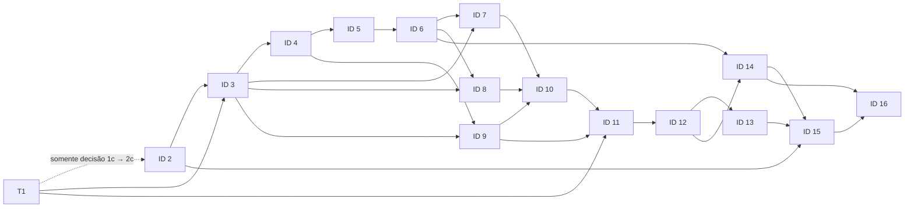

# Plano de implementação: monitoramento jurídico

**Estado:** plano aprovado; decisões documentais dos gates 1–3 registradas para permitir o início da implementação. Compatibilidade, segurança e capacidade ainda exigem verificação real.

O [checklist canônico](todo.md) contém o aceite, a verificação proposta, as dependências e as áreas de arquivos por tarefa. Este plano organiza os IDs principais, seus gates, sequência, dependências e paralelização, sem duplicar o checklist.

## Base aprovada e especificações

O [mapa de capacidades](../CAPABILITIES.md) e as seis especificações funcionais são a referência de escopo. Stack e arquitetura propostas constam de [stack](../docs/stack.md) e [arquitetura](../docs/arquitetura.md); comandos e caminhos específicos serão verificados em cada fatia.

| Módulo | Especificação aprovada |
|---|---|
| identidade | [SPEC-identidade.md](../SPEC-identidade.md) |
| autorização | [SPEC-autorizacao.md](../SPEC-autorizacao.md) |
| monitoramentos | [SPEC-monitoramentos.md](../SPEC-monitoramentos.md) |
| Escriba | [SPEC-escriba.md](../SPEC-escriba.md) |
| coleta | [SPEC-coleta.md](../SPEC-coleta.md) |
| consulta | [SPEC-consulta.md](../SPEC-consulta.md) |

## Gate antes de qualquer implementação

Os IDs **1–3** são decisões documentais anteriores à implementação e estão registrados no checklist. Comandos e caminhos exatos serão confirmados por fatia após criação da aplicação.

- **1–2:** decisões de fonte, segurança e dados registradas no checklist. Capacidade de 300 usuários é referência para avaliação futura, sem bloquear esta entrega.
- **3:** completar decisões da stack já escolhida, versões, arquitetura física, limites entre componentes, políticas RLS, contratos compartilhados e ferramentas/comandos de desenvolvimento e verificação. Definir estrutura e caminhos concretos somente após essas decisões.
- Confirmar que os contratos e escopos de cada tarefa permanecem dentro das seis especificações aprovadas. Mudanças de escopo exigem aprovação, não são presumidas pelo plano.

## Ordem vertical e checkpoints

Executar as fatias em ordem de dependência. IDs são os principais do checklist; se uma fatia exceder 3–5 arquivos, subdividi-la em subtarefas dentro do mesmo ID. Registrar caminhos exatos antes de executar cada fatia.

### Fase 0 — Resolver bloqueios

- **IDs 1 e 2:** podem avançar parcialmente em paralelo; a decisão do subitem 1c deve estar concluída antes do subitem 2c. Ambos são pré-requisitos do ID 3.
- **ID 3:** fechar as decisões técnicas e os contratos necessários para as fatias seguintes.

**Checkpoint após 1–3:** decisões registradas e andamento autorizado pelo solicitante. Verificações de execução e segurança continuam obrigatórias durante a implementação.

### Fase 1 — Identidade e autorização

- **ID 4:** endpoints de onboarding do advogado e contexto de identidade/tenant no backend. A interface frontend fica para etapa posterior e não bloqueia as próximas fatias de backend.
- **ID 5:** usuários e validade da credencial, após os contratos de backend de 4a–4b.
- **ID 6:** grupos e escopos, após ID 5.

**Checkpoint após 4–6:** rever os contratos de identidade, validade, tenant e autorização antes de liberar os consumidores.

### Fase 2 — Monitoramentos e registro do fluxo

- **IDs 7 e 8:** cadastros de partes e processos, em paralelo após os contratos do ID 3 e o ID 6.
- **ID 9:** Escriba append-only; depende dos contratos técnicos e do contexto de identidade, não dos cadastros de monitoramento.

**Checkpoint após 7–9:** confirmar os contratos de identidade/tenant dos monitoramentos e o limite do Escriba antes de planejar coletas.

### Fase 3 — Coleta e estado de execução

- **ID 10:** planejamento por entidade/tenant e tribunal, após IDs 7–9.
- **ID 11:** coleta e persistência, após IDs 1, 9 e 10.
- **ID 12:** deduplicação e preservação de vínculos, após ID 11.
- **ID 13:** agenda, novas tentativas e estado de falha, após ID 12.

**Checkpoint após 10–12:** verificar os contratos propostos de planejamento, persistência e deduplicação. Confirmar coleta primária dos cadernos DJEN ZIP/JSON e fallback pela API paginada da mesma fonte lógica, somente para o dia corrente; deduplicação por `id` e `hash` conjuntamente, com vínculos preservados.

### Fase 4 — Consulta e dashboard

- **ID 14:** consulta independente de comunicações, após IDs 6 e 12.
- **ID 15:** dashboard numérica e sua UI, avisos e restrição de acesso, após IDs 2, 13 e 14. O ID 6 estabelece a política de autorização e escopo que a dashboard aplica; a interface e as volumetrias pertencem somente ao ID 15.

**Checkpoint após 13–15:** rever o estado de falhas por tribunal, a aplicação da autorização nas respostas e os critérios de volumetria acordados.

### Fase 5 — Validação integrada

- **ID 16:** validação ponta a ponta e isolamento após IDs 14 e 15; teste de capacidade fica para o futuro e não bloqueia a entrega.

**Checkpoint final após 16a:** avaliar os critérios funcionais, registrar resultados e obter revisão humana; a avaliação futura de capacidade em 16b não bloqueia esta entrega.

## Grafo de dependências

Cada aresta aponta para um ID posterior; assim, o grafo é acíclico e sua ordem é verificável. A dependência parcial entre os IDs 1 e 2 é somente da decisão do subitem 1c para o subitem 2c:

## Bloqueios técnicos por módulo

| Módulo | IDs | Decisões/bloqueios a resolver antes da implementação |
|---|---:|---|
| identidade | 4–5 | Mecanismo de login e identidade para usuários da equipe; aplicação da validade às credenciais e sessões; início, fuso e instante de expiração; validações de nome/OAB. |
| autorização | 5–6, 14–15 | Composição e conflitos entre grupos; operações e concessões de escrita; escopo de tribunal e dashboard; ações de gestão de usuários/grupos; proteção das respostas e agregações. |
| monitoramentos | 7–8 | Validação e normalização de nome/OAB/número, duplicidades, ciclo de vida; tribunais realmente disponíveis e semântica de filtros; política de correspondência e homônimos, sem presumir algoritmo. |
| Escriba | 9 | Esquema e granularidade dos marcos; contexto de execução; isolamento e proteção append-only. Não registrar ações de usuários nem detalhes de erro; sem expurgo automático nesta etapa. |
| coleta | 1, 10–13 | Critérios de tribunal e elegibilidade; horários e interrupções; validação do ZIP/JSON; demais critérios de falha do caderno; configuração de tentativas/backoff; estados de falha e tratamento de chaves ausentes/inválidas. A regra de paginação do fallback está definida na especificação de coleta. |
| consulta | 14–15 | Definição de métricas, unidade e janelas; comportamento de agregações sob escopo parcial; campos efetivamente fornecidos pela fonte; apresentação de falha distinta de zero e de números sem autorização. |
| transversal | 3, 16 | Stack central escolhida: Rails API-only, Next.js e PostgreSQL/RLS. Faltam versões, stack de ETL, políticas/roles RLS, caminhos de código, arquitetura/transportes, comandos/ferramentas e metas de carga de 300 usuários. |

## Oportunidades de paralelização e contratos compartilhados

| Fatias paralelizáveis | Condição para paralelizar sem conflito |
|---|---|
| IDs 1 e 2 | Podem avançar parcialmente em paralelo; a decisão do subitem 1c precisa estar concluída antes do subitem 2c. |
| IDs 5 e 9 | Após IDs 3 e 4, os contratos de identidade e tenant devem estar fixos; separar áreas de arquivo e evitar alterações concorrentes no contrato compartilhado. |
| IDs 7 e 8 | Após os contratos do ID 3 e o ID 6, com a definição compartilhada de identidade de monitoramento, tenant e filtro de tribunal; limitar cada fatia à sua entidade e áreas de arquivo próprias. |
| IDs 13 e 14 | Após ID 12 e a estabilização do contrato de estado da coleta, podem avançar em módulos distintos; ID 15 aguarda ambos. |

Não paralelizar tarefas com dependência direta nem alterações concorrentes a um mesmo contrato ou arquivo. Antes de dividir o trabalho, fixar: contexto autenticado e tenant derivado no servidor; decisão de autorização por operação/tribunal/dashboard; identidade e tenant do monitoramento fornecidos à coleta; registros append-only do Escriba sem detalhes de erro; estado por execução/tribunal; e identidade de publicação pela combinação conjunta `id` + `hash`, escopada por tenant e fonte lógica DJEN.

## Riscos e mitigação

| Risco dentro do escopo aprovado | Mitigação planejada |
|---|---|
| Contrato da fonte, filtros, cobertura e paginação não comprovados para todos os tribunais. | Validar evidências e limites antes do gate 3; usar cadernos ZIP/JSON como caminho principal e consulta paginada como fallback da mesma fonte lógica, sem prometer cobertura não demonstrada. |
| Divergência de nome, homônimos ou filtro por processo pode causar resultados indevidos ou ausentes. | Manter critérios de correspondência e semântica da fonte como decisões explícitas; não inventar normalização nem tratar uma amostra como garantia geral. |
| `id` e `hash` podem não ter estabilidade/unicidade global comprovada. | Tratar estabilidade como premissa limitada; deduplicar apenas pela combinação conjunta, por tenant e DJEN, preservando vínculos e sem fundir por processo/tribunal. |
| Horários, fuso, critérios de fallback e política de tentativas ainda não definidos. | Aprovar elegibilidade, condições e limites antes de configurar execução; não inferir quantidade, intervalos ou recuperação de dias anteriores. |
| Dados pessoais em registros imutáveis, ainda que públicos. | Minimizar dados registrados, manter isolamento e avaliar obrigações legais aplicáveis antes de produção. |
| Regras de grupo e dashboard podem permitir exposição indevida ou bloquear acesso esperado. | Definir composição e escopos; aplicar decisões no servidor a listas, detalhes, respostas e agregações, preservando as regras funcionais aprovadas. |
| Capacidade para 300 usuários não foi medida. | Tratar 300 como referência e planejar teste futuro; não afirmar capacidade sem medição. |
| Versões, ETL, políticas RLS, caminhos e comandos ainda não definidos. | Completar ID 3 a partir da stack central escolhida; depois fixar caminhos reais, limitar cada fatia a 3–5 arquivos e subdividir acima desse limite. |

## Fronteiras e execução

Manter o escopo das seis especificações: DJEN como fonte lógica, cadernos ZIP/JSON primários, API paginada como fallback, data corrente exclusiva por execução e deduplicação pela combinação conjunta `id` + `hash`. Não introduzir coleta histórica automática, e-mail, fontes adicionais ou regras de negócio não aprovadas.

`dev` é a base das features; quando os gates liberarem a implementação, cada feature parte de `dev` em `feature/<nome>` e integra após revisão. Os caminhos físicos de código e comandos ficam pendentes do ID 3; não os inventar neste plano.

A implementação incremental segue a regra de `source-driven-development` do [checklist](todo.md#regras-de-execução-e-rastreio): verificar versões e documentação oficial antes das decisões dependentes de tecnologia, registrar fontes e validar o comportamento em execução.

As verificações do [checklist](todo.md) são propostas e ainda não foram executadas. Nenhum comando de build, teste, lint ou formatação foi presumido.
