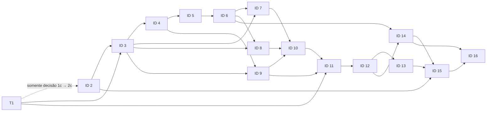

# Plano de implementação: monitoramento jurídico

**Estado:** plano aprovado; decisões documentais dos gates 1–3 registradas para permitir o início da implementação. Compatibilidade, segurança e capacidade ainda exigem verificação real.

O [checklist canônico](todo.md) contém o aceite, a verificação proposta, as dependências e as áreas de arquivos por tarefa. Este plano organiza os IDs principais, seus gates, sequência, dependências e paralelização, sem duplicar o checklist.

## Base aprovada e especificações

O [mapa de capacidades](../CAPABILITIES.md) e as seis especificações funcionais são a referência de escopo. Stack e arquitetura propostas constam de [stack](../docs/stack.md) e [arquitetura](../docs/arquitetura.md); comandos e caminhos específicos serão verificados em cada fatia.

| Módulo | Especificação aprovada |
|---|---|
| identidade | [SPEC-identidade.md](../SPEC-identidade.md) |
| autorização | [SPEC-autorizacao.md](../SPEC-autorizacao.md) |
| monitoramentos | [SPEC-monitoramentos.md](../SPEC-monitoramentos.md) |
| Escrevente | [SPEC-escrevente.md](../SPEC-escrevente.md) |
| coleta | [SPEC-coleta.md](../SPEC-coleta.md) |
| consulta | [SPEC-consulta.md](../SPEC-consulta.md) |

## Gate antes de qualquer implementação

Os IDs **1–3** são decisões documentais anteriores à implementação e estão registrados no checklist. Comandos e caminhos exatos serão confirmados por fatia após criação da aplicação.

- **1–2:** decisões de fonte, segurança e dados registradas no checklist. Capacidade de 300 usuários é referência para avaliação futura, sem bloquear esta entrega.
- **3:** completar decisões da stack já escolhida, versões, arquitetura física, limites entre componentes, políticas RLS, contratos compartilhados e ferramentas/comandos de desenvolvimento e verificação. Definir estrutura e caminhos concretos somente após essas decisões.
- Confirmar que os contratos e escopos de cada tarefa permanecem dentro das seis especificações aprovadas. Mudanças de escopo exigem aprovação, não são presumidas pelo plano.

## Ordem vertical e checkpoints

Executar as fatias em ordem de dependência. IDs são os principais do checklist; se uma fatia exceder 3–5 arquivos, subdividi-la em subtarefas dentro do mesmo ID. Registrar caminhos exatos antes de executar cada fatia.

### Fase 0 — Resolver bloqueios

- **IDs 1 e 2:** podem avançar parcialmente em paralelo; a decisão do subitem 1c deve estar concluída antes do subitem 2c. Ambos são pré-requisitos do ID 3.
- **ID 3:** fechar as decisões técnicas e os contratos necessários para as fatias seguintes.

**Checkpoint após 1–3:** decisões registradas e andamento autorizado pelo solicitante. Verificações de execução e segurança continuam obrigatórias durante a implementação.

### Fase 1 — Identidade e autorização

- **ID 4:** endpoints de onboarding do advogado e contexto de identidade/tenant no backend. A interface frontend fica para etapa posterior e não bloqueia as próximas fatias de backend.
- **ID 5:** usuários e validade da credencial, após os contratos de backend de 4a–4b.
- **ID 6:** grupos e escopos, após ID 5.

**Checkpoint após 4–6:** rever os contratos de identidade, validade, tenant e autorização antes de liberar os consumidores.

### Fase 2 — Monitoramentos e registro do fluxo

- **IDs 7 e 8:** cadastros de partes e processos, em paralelo após os contratos do ID 3 e o ID 6.
- **ID 9:** Escrevente append-only; depende dos contratos técnicos e do contexto de identidade, não dos cadastros de monitoramento.

**Checkpoint após 7–9:** confirmar os contratos de identidade/tenant dos monitoramentos e o limite do Escrevente antes de planejar coletas.

### Fase 3 — Coleta e estado de execução

- **ID 10:** planejamento por entidade/tenant e tribunal, após IDs 7–9.
- **ID 11:** coleta e persistência, após IDs 1, 9 e 10.
- **ID 12:** deduplicação e preservação de vínculos, após ID 11.
- **ID 13:** agenda, novas tentativas e estado de falha, após ID 12.

**Checkpoint após 10–12:** verificar os contratos propostos de planejamento, persistência e deduplicação. Confirmar somente Diário Eletrônico (`D`), sem editais (`E`): cadernos DJEN ZIP/JSON e fallback paginado no primeiro slot, API paginada diretamente no segundo, sem caderno, somente para o dia corrente e na mesma fonte lógica. Sanitizar apenas texto da API, não do caderno; a deduplicação por `id` e `hash` conjuntamente preserva vínculos e a primeira versão, que pode conter HTML e exige escape pelo consumidor.

#### Plano da branch 13a–13b — execução e recuperação

**Objetivo:** ligar os trabalhos duráveis já planejados ao processo `etl/`, sem mover o processamento para a API Rails nem alterar as regras de fonte, identidade ou tenant. `backend/despachante/run.rb` planeja slots; `etl/bin/processador` consome a fila e também aceita um UUID específico.

1. **Contrato de seleção:** `app_private.processor_next(limite)` seleciona e concede trabalho por transação, usando `FOR UPDATE SKIP LOCKED`; expõe apenas UUID, estado e token à role do processador. Instâncias concorrentes não obtêm a mesma concessão, retomam trabalho após expiração e ignoram datas futuras e estados terminais. Trabalho antigo só é concedido para registrar interrupção, sem acesso à fonte.
2. **13a — Execução:** integrar os slots planejados à execução dos trabalhos, reutilizando as tentativas, esperas, limites, fallback e estados persistentes do processador. Preservar separação de processos e diferenciar falha, pendência e sucesso vazio por execução/tribunal.
3. **13b — Recuperação:** retomar pendências do mesmo dia após interrupção e executar cada slot devido uma vez; não repetir trabalho concluído. Uma segunda execução pode recuperar o resultado da primeira, preservando sua falha, deduplicação e vínculos. Na virada local, não consultar datas anteriores; manter a interrupção identificável.
4. **Verificação:** cenários controlados em PostgreSQL com dois slots e processos reais: concorrência e reinício; falha após tentativas e sucesso vazio; recuperação no segundo slot; virada de data; isolamento de tenants e preservação de identidade. Exercitar a entrada de execução definitiva e registrar comandos e resultados. Qualquer variável introduzida ou alterada deve ser registrada no README.

**Fronteiras:** somente Diário Eletrônico `D`, sem editais; primeiro slot por caderno com fallback, segundo pela API; sem coleta retroativa, telas, dashboard ou nova instância PostgreSQL de deploy. O processador é um processo supervisionado separado; a espera ociosa é de cinco segundos e não requer configuração adicional.

### Fase 4 — Consulta e dashboard

- **ID 14:** consulta independente de comunicações, após IDs 6 e 12.
- **ID 15:** dashboard numérica e sua UI, avisos e restrição de acesso, após IDs 2, 13 e 14. O ID 6 estabelece a política de autorização e escopo que a dashboard aplica; a interface e as volumetrias pertencem somente ao ID 15.

#### Branch 14a–15b — backend de consulta e dashboard

O escopo desta branch é o backend: as interfaces e a aprovação dos checkpoints permanecem pendentes. Os endpoints de consulta e dashboard reutilizam a sessão autenticada, o bloqueio de autorização e as políticas RLS existentes; o tenant nunca é aceito do cliente.

1. **Consulta:** `backend/app/controllers/communications_controller.rb` e eventuais serviços específicos consultam comunicações e vínculos preservados pela coleta, aplicando a autorização por tribunal à lista e ao detalhe. As comunicações permanecem independentes; pendências de identidade mantêm o aviso. O conteúdo da fonte é não confiável e a futura interface deve escapá-lo.
2. **Dashboard:** `backend/app/controllers/dashboard_controller.rb` e eventuais serviços específicos calculam as duas métricas e as três janelas aprovadas, com recorte por tribunais autorizados e estados operacionais. Negação da dashboard devolve `*` sem disponibilizar o valor protegido; falha, ausência de conclusão e zero permanecem distintos.
3. **Integração:** `backend/config/routes.rb` expõe os endpoints; testes HTTP próprios em `backend/test/integration/` verificam tenants, grupos, tribunais, pendências, janelas, falhas e recuperação. O README registra os contratos HTTP e suas limitações. Não há frontend nem alteração das fontes de coleta.
4. **Verificação:** executar testes focados e suíte existente usando PostgreSQL descartável com roles reais; exercitar o caminho HTTP definitivo com dados controlados, inclusive negação e estado terminal. As tarefas 14a e 15b só serão encerradas integralmente quando a interface também for entregue.

#### Branch frontend-web — implementação da interface

**Escopo:** implementar em `apps/web/` as telas de identidade, monitoramentos, consulta, dashboard, equipe, grupos e histórico operacional de [SPEC-web.md](../apps/web/SPEC-web.md), integradas à API existente. A exportação Banani é referência visual; regras aprovadas e o design system prevalecem sobre dados ou controles ilustrativos.

1. **Base e identidade:** Next.js App Router, TypeScript e npm com dependências fixadas; manter sessão, cookies seguros, Origin e CSRF da API Rails. O callback Google atualmente retorna JSON: o frontend deve encaminhá-lo ao Rails, preservar os cookies e concluir a navegação. Aceite de convite deve preservar o fragmento sem expor segredo.
2. **Fatias independentes:** monitoramentos de advogado, partes e processos; consulta/dashboard e histórico; equipe e grupos. Todas usam o mesmo cliente HTTP, respostas reais e estados de erro, sem dados fictícios, cache compartilhado, editais ou funcionalidades de agenda.
3. **Integração:** verificar autorização, dados de dois tenants, texto da fonte como texto inerte, falha/zero/máscara e formulários no navegador headless, com API Rails e PostgreSQL descartável. Login Google real depende de credenciais externas; cenários preparados não comprovam OAuth real.
4. **Entrega:** executar build, verificações focadas e CI; documentar comandos, configurações e limitações. Nenhuma aprovação humana de checkpoint ou deploy é presumida. Imagens devem respeitar as regras de usuário não root e gates de containerização.

**Checkpoint após 13–15:** rever o estado de falhas por tribunal, a aplicação da autorização nas respostas e os critérios de volumetria acordados.

### Fase 5 — Validação integrada

- **ID 16:** validação ponta a ponta e isolamento após IDs 14 e 15; teste de capacidade fica para o futuro e não bloqueia a entrega.

**Checkpoint final após 16a:** avaliar os critérios funcionais, registrar resultados e obter revisão humana; a avaliação futura de capacidade em 16b não bloqueia esta entrega.

## Grafo de dependências

Cada aresta aponta para um ID posterior; assim, o grafo é acíclico e sua ordem é verificável. A dependência parcial entre os IDs 1 e 2 é somente da decisão do subitem 1c para o subitem 2c:

## Bloqueios técnicos por módulo

| Módulo | IDs | Decisões/bloqueios a resolver antes da implementação |
|---|---:|---|
| identidade | 4–5 | Mecanismo de login e identidade para usuários da equipe; aplicação da validade às credenciais e sessões; início, fuso e instante de expiração; validações de nome/OAB. |
| autorização | 5–6, 14–15 | Composição e conflitos entre grupos; operações e concessões de escrita; escopo de tribunal e dashboard; ações de gestão de usuários/grupos; proteção das respostas e agregações. |
| monitoramentos | 7–8 | Validação e normalização de nome/OAB/número, duplicidades, ciclo de vida; tribunais realmente disponíveis e semântica de filtros; política de correspondência e homônimos, sem presumir algoritmo. |
| Escrevente | 9 | Esquema e granularidade dos marcos; contexto de execução; isolamento e proteção append-only. Não registrar ações de usuários nem detalhes de erro; sem expurgo automático nesta etapa. |
| coleta | 1, 10–13 | Critérios de tribunal e elegibilidade; horários e interrupções; validação do ZIP/JSON; demais critérios de falha do caderno; configuração de tentativas/backoff; estados de falha e tratamento de chaves ausentes/inválidas. A regra de paginação do fallback está definida na especificação de coleta. |
| consulta | 14–15 | Definição de métricas, unidade e janelas; comportamento de agregações sob escopo parcial; campos efetivamente fornecidos pela fonte; apresentação de falha distinta de zero e de números sem autorização. |
| transversal | 3, 16 | Stack central escolhida: Rails API-only, Next.js e PostgreSQL/RLS. Faltam versões, stack de ETL, políticas/roles RLS, caminhos de código, arquitetura/transportes, comandos/ferramentas e metas de carga de 300 usuários. |

## Oportunidades de paralelização e contratos compartilhados

| Fatias paralelizáveis | Condição para paralelizar sem conflito |
|---|---|
| IDs 1 e 2 | Podem avançar parcialmente em paralelo; a decisão do subitem 1c precisa estar concluída antes do subitem 2c. |
| IDs 5 e 9 | Após IDs 3 e 4, os contratos de identidade e tenant devem estar fixos; separar áreas de arquivo e evitar alterações concorrentes no contrato compartilhado. |
| IDs 7 e 8 | Após os contratos do ID 3 e o ID 6, com a definição compartilhada de identidade de monitoramento, tenant e filtro de tribunal; limitar cada fatia à sua entidade e áreas de arquivo próprias. |
| IDs 13 e 14 | Após ID 12 e a estabilização do contrato de estado da coleta, podem avançar em módulos distintos; ID 15 aguarda ambos. |

Não paralelizar tarefas com dependência direta nem alterações concorrentes a um mesmo contrato ou arquivo. Antes de dividir o trabalho, fixar: contexto autenticado e tenant derivado no servidor; decisão de autorização por operação/tribunal/dashboard; identidade e tenant do monitoramento fornecidos à coleta; registros append-only do Escrevente sem detalhes de erro; estado por execução/tribunal; e identidade de publicação pela combinação conjunta `id` + `hash`, escopada por tenant e fonte lógica DJEN.

## Riscos e mitigação

| Risco dentro do escopo aprovado | Mitigação planejada |
|---|---|
| Contrato da fonte, filtros, cobertura e paginação não comprovados para todos os tribunais. | Validar evidências e limites antes do gate 3; somente para Diário Eletrônico (`D`), usar cadernos ZIP/JSON com fallback paginado no primeiro slot e API paginada diretamente no segundo, sem prometer cobertura não demonstrada nem coletar editais (`E`). |
| Divergência de nome, homônimos ou filtro por processo pode causar resultados indevidos ou ausentes. | Manter critérios de correspondência e semântica da fonte como decisões explícitas; não inventar normalização nem tratar uma amostra como garantia geral. |
| `id` e `hash` podem não ter estabilidade/unicidade global comprovada. | Tratar estabilidade como premissa limitada; deduplicar apenas pela combinação conjunta, por tenant e DJEN, preservando vínculos e sem fundir por processo/tribunal. |
| Horários, fuso, critérios de fallback e política de tentativas ainda não definidos. | Aprovar elegibilidade, condições e limites antes de configurar execução; não inferir quantidade, intervalos ou recuperação de dias anteriores. |
| Dados pessoais em registros imutáveis, ainda que públicos. | Minimizar dados registrados, manter isolamento e avaliar obrigações legais aplicáveis antes de produção. |
| Regras de grupo e dashboard podem permitir exposição indevida ou bloquear acesso esperado. | Definir composição e escopos; aplicar decisões no servidor a listas, detalhes, respostas e agregações, preservando as regras funcionais aprovadas. |
| Capacidade para 300 usuários não foi medida. | Tratar 300 como referência e planejar teste futuro; não afirmar capacidade sem medição. |
| Mudanças nas versões, políticas RLS e dependências podem invalidar os comandos ou as garantias existentes. | Manter versões e comandos explícitos, validar roles reais e revisar cada fatia antes de avançar. |

## Fronteiras e execução

Manter o escopo das seis especificações: DJEN como fonte lógica, exclusivamente Diário Eletrônico (`D`), sem editais (`E`); cadernos ZIP/JSON com fallback paginado no primeiro slot; API paginada diretamente no segundo, sem caderno; data corrente exclusiva por execução; sanitização somente do texto da API, não do caderno; deduplicação pela combinação conjunta `id` + `hash`, preservando a primeira versão, que pode conter HTML e deve ser escapada pelo consumidor. Evidências anteriores com `E` são históricas, não regras vigentes. Convites de equipe por e-mail pertencem ao escopo de identidade; não introduzir coleta histórica automática, relatórios ou avisos por e-mail, fontes adicionais ou regras de negócio não aprovadas.

`dev` é a base das features; cada feature parte de `dev` em `feature/<nome>` e integra após revisão. Caminhos e comandos existentes são registrados no checklist e no README; caminhos previstos não representam implementação.

A implementação incremental segue a regra de `source-driven-development` do [checklist](todo.md#regras-de-execução-e-rastreio): verificar versões e documentação oficial antes das decisões dependentes de tecnologia, registrar fontes e validar o comportamento em execução.

Resultados e limitações das verificações efetivamente executadas são registrados no [checklist](todo.md) e no [README](../README.md#implementação-e-verificações); tarefas ainda não executadas mantêm suas verificações propostas como pendentes.
